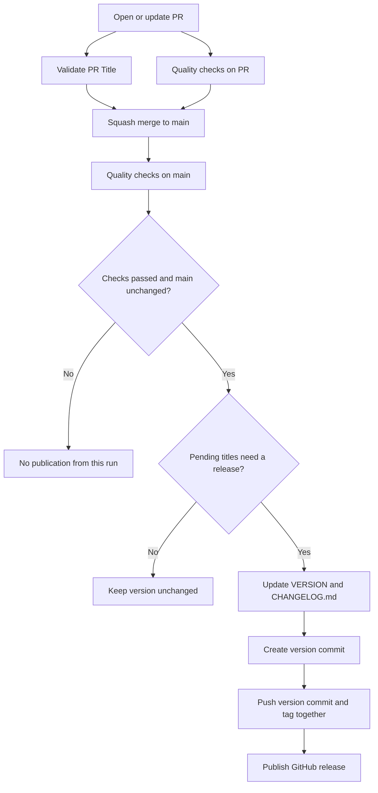

# Automatic Releases

Squash merge a PR into `main`. Once the main-branch quality checks pass,
the workflow publishes a release if the squash commit title calls for one.
There is no manual version update or release PR.

## Release Rules

All examples start from `v1.0.0`.

| PR title | Result | Next version |
| --- | --- | --- |
| `fix: correct uptime display` | Patch | `v1.0.1` |
| `perf: reduce startup time` | Patch | `v1.0.1` |
| `revert: restore configuration` | Patch | `v1.0.1` |
| `feat: add update notifications` | Minor | `v1.1.0` |
| `feat!: change configuration layout` | Major | `v2.0.0` |
| `chore: update repository stats` | No release | Unchanged |
| `chore: sync readme metadata` | No release | Unchanged |
| `docs: clarify installation` | No release | Unchanged |

**Scopes are optional.** `feat: add notifications` and
`feat(updates): add notifications` both produce a minor release.

```text
type: description
type(scope): description
type!: breaking change description
type(scope)!: breaking change description
```

- Use a supported lowercase type, `: `, and a description with no leading whitespace.
- An optional scope must not be empty or contain nested parentheses.
- `docs`, `style`, `refactor`, `test`, `build`, `ci`, and `chore` normally skip releases.
- Adding `!` to any supported type makes it a major release, including `chore!:`.
- Individual branch commits do not determine the version update. Keep the final squash
  commit title identical to the validated PR title when merging.

> A valid PR title does **not** necessarily produce a release.
> Maintenance titles pass validation but do not trigger a version update on their own.

## Release Flow



After a qualifying merge:

1. **Check:** wait for the push-triggered `Quality` workflow on `main` to succeed.
2. **Calculate:** read titles since the last commit that changed `VERSION` and choose the highest-priority version update.
3. **Write:** update `VERSION` and prepend a dated entry to `CHANGELOG.md`.
   The entry lists all pending titles, including maintenance changes.
4. **Commit:** create `chore(release): vX.Y.Z` containing both files.
5. **Tag:** push that version-containing commit and its matching `vX.Y.Z` tag atomically.
6. **Publish:** create the GitHub release with the same notes as the changelog entry.

The tag points to the **version commit**, not the earlier squash merge.
Generated release commits are excluded from release processing to prevent loops.

### Fast Merges and Failed Checks

| Situation | What happens |
| --- | --- |
| Main-branch quality checks fail | No release is published. |
| Another commit reaches `main` before preparation | The older run skips publication; a later successful run includes pending changes. |
| Several merges are pending | They can share one release. Major takes priority over minor, then patch. |
| Only maintenance commits are pending | No version change, changelog update, tag, or release. |
| `main` advances during the push | The atomic push fails without pushing either the version commit or tag. |
| The generated release commit runs checks | Checks may run, but another release is not created. |

Release jobs run one at a time. Pending changes remain available for the next
successful run rather than being discarded when an older run skips publication.

## Repository Configuration

- **Aviel Dots Release** is authorized to publish, using `RELEASE_APP_ID` and
  `RELEASE_APP_PRIVATE_KEY`. Only this App bypasses protection on `main`.
- Use squash merges with the PR title as the commit title, and require title
  validation and quality checks before merging.
- Let the workflow update `VERSION`; no manual version update is needed.

Release timing depends on checks and runner availability. Other devices see
the release on their next update check; installation is a separate step.

## Maintenance

### Files

| File | Responsibility |
| --- | --- |
| [pr-title.yml](../.github/workflows/pr-title.yml) | Run PR-title validation. |
| [quality.yml](../.github/workflows/quality.yml) | Run release tests and repository quality checks. |
| [release.yml](../.github/workflows/release.yml) | Coordinate version preparation, commit, tag, and publication. |
| [release_rules.py](../.github/scripts/release_rules.py) | Validate titles and calculate versions. |
| [validate_pr_title.py](../.github/scripts/validate_pr_title.py) | Report title validation success or failure to Actions. |
| [release.py](../.github/scripts/release.py) | Read Git history and write release files. |
| [test_release.py](../.github/scripts/test_release.py) | Test the rules and release preparation using Arrange, Act, Assert. |

### Run the Tests

From the repository root, with Python and Git available:

```sh
python -m unittest discover -s .github/scripts -p 'test_release.py' -v
```

### Dependencies

The release scripts have **no third-party Python packages** and need no
`pip install`. The rules module has no imports. Other scripts use modules
that ship with Python for files, Git subprocesses, dates, and environment variables.
Importing them does not download or install anything.

The workflows select Python 3.12 explicitly for predictable behavior. Git and
GitHub CLI handle repository writes and publication; no Node.js setup is needed.