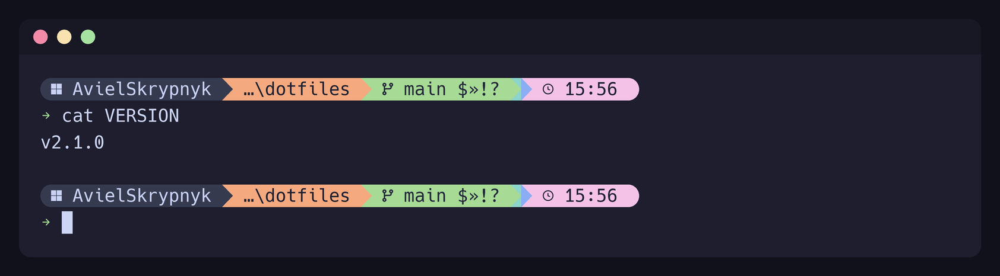
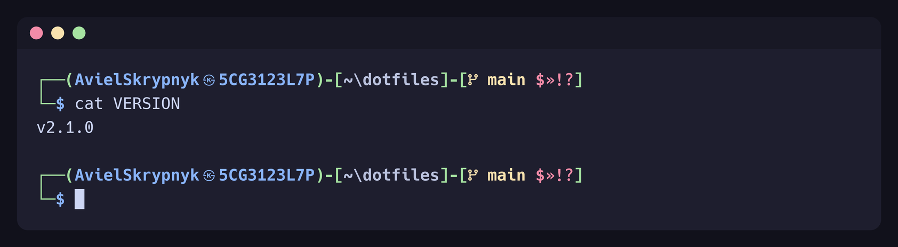
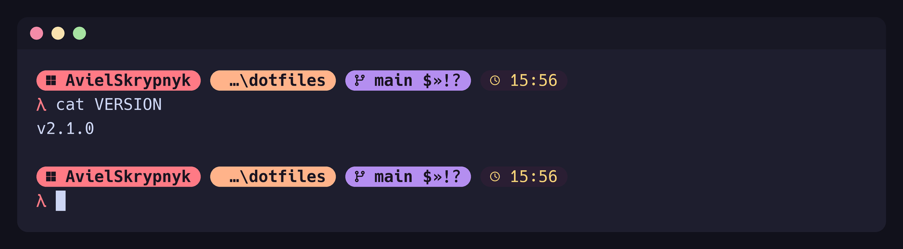

# Starship Styles

Prompt styles live in `common/.config/starship/`. Starship reads
`~/.config/starship.toml`, which `starship-style` links to the chosen style.

## Usage

```sh
starship-style          # show the styles and ask which one
starship-style kali     # switch straight to a style
```

The next prompt uses the new style; no shell restart needed. The bootstrap
installer asks the same question on first install.

| OS | Script | How it switches |
|---|---|---|
| macOS / Linux | `common/scripts/starship-style/starship-style` (bash, linked in `common/bin`) | symlink |
| Windows | `common/scripts/starship-style/starship-style.ps1` (profile function `starship-style`) | hard link |

On Windows a `git pull` that changes the active style breaks the hard link, so
re-run `starship-style <name>` afterwards.

## Available Styles

| Style | Look |
|---|---|
| `default` | Catppuccin Macchiato powerline |
| `kali` | Kali Linux like two-line prompt |
| `sunset` | Warm rounded pills just looks nice |

### default



### kali



### sunset



## Credits

The `default` layout started from
[typecraft-dev/dotfiles](https://github.com/typecraft-dev/dotfiles).
